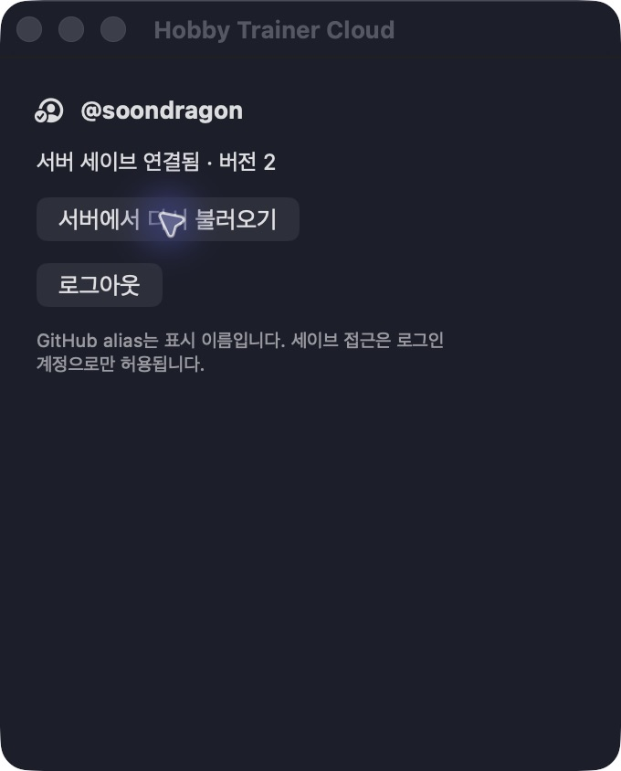
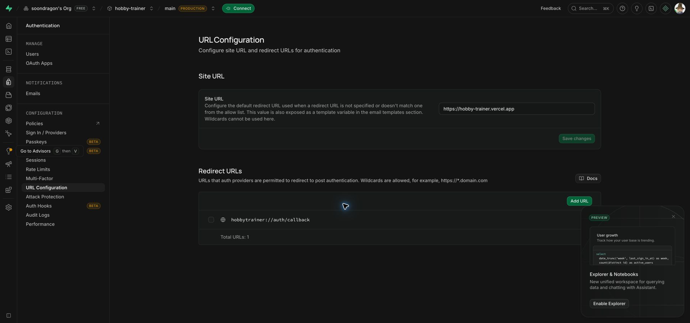
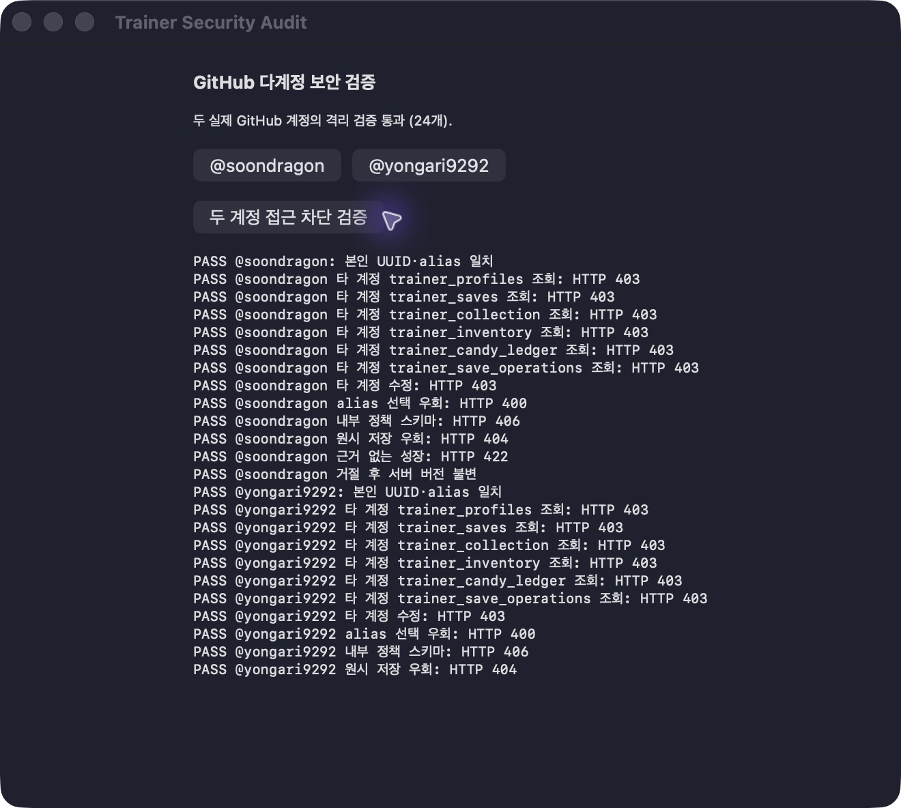

# Account-owned cloud saves

**Current authentication implementation:** [GitHub public-profile authentication](public-profile-auth.md).
The new no-email API is deployed; real OAuth reauthorization remains pending (see the linked status). Historical production
verification below refers to the earlier Supabase Auth adapter.

The cloud build uses GitHub public-profile authentication and Supabase PostgreSQL, with a Python 3.12 FastAPI API on Vercel.
It never loads, imports, exports, backs up, or falls back to a local Pokémon save. The old file
is left untouched. Device preferences and authentication credentials are separate from game saves.

## Runtime flow

1. The user signs in directly with GitHub using empty OAuth scopes, state and S256 PKCE.
2. The backend verifies only the public numeric GitHub ID and alias and issues opaque application
   sessions. Device-only Keychain storage uses a separate versioned namespace.
3. The API binds each hashed application token to its owner in a private database function; a
   dedicated restricted database role replaces user JWT forwarding. There is no email lookup.
4. The database derives ownership from `auth.uid()` and the server-verified GitHub account mapping.
   GitHub alias is display data. A caller cannot select someone else's save by supplying an alias.
5. `GET /api/companion` returns the authenticated user's save. An absent save requires an explicit
   **Start on server** action. Only a successful server receipt unlocks gameplay.
6. Native changes are coalesced for 300 ms, then serialized. A version check rejects stale writes.
   An idempotency UUID binds the exact payload and version so a lost acknowledgement can be retried.
7. Authentication, connectivity, or version failures freeze gameplay. There is no local fallback or
   silent last-write-wins merge. Conflict recovery requires explicit discard and server reload.

The server is the durable source of Pokémon state. Unacknowledged changes exist only in memory;
the full app warns before normal termination. Force quitting can lose unacknowledged changes.
This version uses explicit reload/conflict recovery rather than background multi-device merging.
Use one active writer per account; provider usage baselines are currently part of that shared save.

## Save structure and normalization

The original `CompanionState` JSON contained the active individual, collected individuals (`dex`),
wallet/progression counters, egg state, inventory, provider usage baselines, candy grants, and locale.
Difficulty settings are stored with the server growth policy and restored together with the save.

| Table | Responsibility |
| --- | --- |
| `trainer_profiles` | Stable owner UUID, verified GitHub provider ID, display alias |
| `trainer_saves` | Schema version, revision, bounded core state, update time |
| `trainer_collection` | Individual ID, order, species IDs, shiny flag, remaining individual details |
| `trainer_inventory` | Item kind and quantity per owner |
| `trainer_candy_ledger` | Grant tier and window epoch per owner and provider/window key |
| `trainer_save_operations` | Bounded idempotency history, payload digest, applied revision |

The API and database both validate the payload. Unknown fields, excessive sizes, invalid counters,
duplicate individual IDs, and invalid nested individual profiles are rejected. The database embeds
the strict schema generated from `server/app/models.py`; model changes require a schema migration.
Do not pass individual profile seeds through JavaScript numbers: they are UInt64 values. Python's
integer JSON parser and PostgreSQL JSONB preserve their exact value, including `2^64 - 1`.

## Security boundaries

- Direct table reads and writes are revoked, including owner reads. RLS remains enabled as defense in depth.
- Public read/write RPCs run as security invoker. Their guarded implementations are in the
  nonexposed `trainer_internal` schema. Raw snapshot helpers cannot be executed by clients.
- The new API accepts opaque application tokens and binds their owner inside a private function.
  Guarded RPCs validate the bound session, including immediate logout/expiry. Compatibility with
  existing Auth sessions is confined to the database transition; the new API rejects old JWTs.
- The new adapter's GitHub client secret and restricted DB credential are backend environment
  secrets only. They never enter source, app resources, logs, or the native public configuration.
  The old provider secret remains in Supabase until coordinated activation retires that adapter.
- Credentials are not placed in query strings or preference files. HTTP redirects carrying bearer
  tokens are refused, HTTP caches are disabled, and API errors do not echo private save payloads.
- The automatic-RLS trigger's unnecessary client execute permission is revoked separately.
- This protects one user's data from other users. It does **not** make client-generated XP or stats
  cheat-proof. Future invitation battles require server-authoritative battle rules and commands,
  separate from a player's editable collection save. No battle feature is implemented here.

## Development and deployment

Public configuration: `config/TrainerCloud.json`. Never add a secret/service-role key to it.

```sh
bash scripts/build-cloud-app.sh
open "$HOME/Applications/PokeTokenBar Cloud.app"
```

The cloud app is installed separately from the upstream app and the older local-save hobby app.
`scripts/build-cloud-preview.sh` builds only the authentication/account window for debugging.
The native callback is `hobbytrainer://auth/callback`; GitHub must register this exact URI.
The current GitHub OAuth callback is exactly `hobbytrainer://auth/callback`; activation must update
the existing app registration from the previous Supabase HTTPS callback.

Vercel project root is `server`, using the FastAPI preset and Python 3.12. Current backend settings:
`GITHUB_PROFILE_CLIENT_ID`, `GITHUB_PROFILE_CLIENT_SECRET`, `TRAINER_DATABASE_URL` (server only). Preview deployment protection remains enabled; production
API requests are protected by Supabase user authentication. Apply migrations in filename order.
The current API is at `https://hobby-trainer.vercel.app/api/health`.

```sh
cd server
python3.12 -m venv .venv
.venv/bin/pip install -r requirements.lock
.venv/bin/python -m pytest -q
```

Real PostgreSQL isolation/concurrency tests additionally require `TRAINER_TEST_DATABASE_URL` pointing
to a **disposable local** database named `trainer_test`. The fixture refuses remote databases and
preexisting application database names. It bootstraps minimal Auth roles/tables for these tests;
real GitHub sign-in must also be verified independently against the configured Supabase project.

Native regression selection includes `CloudPersistenceTests`, `CloudSynchronizationTests`,
`CompanionStoreTests`, `CompanionIdentityTests`, and the existing balance/save/profile suites.
The callback test invokes the actual adapter on a background queue, including a late cancellation.
Manual checks must cover sign-in, session restoration, new server save, reload, and relaunch.

## Verification on 2026-10-15

- 185 focused Swift tests passed, including cloud isolation, lost-acknowledgement retry, foreign-owner
  rejection, conflict recovery, background callback delivery, and existing Pokémon mechanics.
- 14 API/PostgreSQL tests passed against a disposable PostgreSQL 17 container. These cover owner
  isolation, anonymous/direct-write rejection, concurrent version checks, exact UInt64 round-trip,
  idempotency, rejected local-import operations, and schema drift.
- The production health endpoint returned 200; unauthenticated save reads returned 401.
- The full local cloud app restored the real GitHub account, created a new server-only save,
  reloaded revision 1, then restarted, persisted the real provider baseline as revision 2, and
  reloaded revision 2. The corresponding row was independently verified in Supabase.
- The old local companion file's size and modification time stayed unchanged across this cloud
  save and application restart. No legacy file was imported.





## Growth validation and real account audit (2026-10-15)

The existing local token-log integration is retained by user choice. The database validates token
ledger deltas, wallet monotonicity, spending, inventory consumption, bounded grants, active individual
identity, growth/level ceilings, evolution routes, graduation, hatch costs, repeat boosts, and Ditto
reveal transitions. A private catalog derived from the official PokéAPI species dataset constrains
newborn rarity and legal evolution paths. Rules are validated in the database even when a caller
bypasses Vercel and invokes an RPC directly. Request IDs remain idempotent under concurrent retries.

The server limits new reported usage to a 25-million-token burst, refilling 100,000 tokens per second,
and quota candies to 30 per server day. A legitimate offline usage backlog larger than the burst is
currently rejected; it is not silently dropped or partially acknowledged. Local token evidence and
quota reports are self-reported, so a forged but internally consistent report within those limits can
still pass. Initial hatch RNG, IVs and public species metadata are not server-attested. This is bounded
validation, not a cheat-proof competitive system. Battle logic remains absent.

Real GitHub accounts `soondragon` and `yongari9292` completed 24 production checks: each read returned
its own UUID and alias; cross-account reads of all six tables and cross-account PATCH returned 403;
alias selection returned 400; private schema access returned 406; raw writer lookup returned 404.
For the account with an existing save, an unbacked growth request returned 422 and its revision stayed
unchanged. The second account had no save, so its growth-write probe was intentionally skipped.
No player snapshots or credentials were exported by the diagnostic app.

Local validation: 34 API/PostgreSQL tests and 161 focused native tests passed, including logout failure recovery. Supabase security advisors reported only intentional deny-all private tables
(INFO) and the existing disabled leaked-password check (WARN). Password login is not used by this
app; application access additionally requires a GitHub identity. No security setting was weakened.

Deployment status: DB migrations are applied. The email-free API is now deployed through an isolated, authorized CLI session in the verified Chrome profile.
See public-profile authentication and floating encounter documentation for current activation and verification limits.

### End-user login permissions

Users need GitHub authentication only. The current adapter requests empty scopes; see
[public-profile auth](public-profile-auth.md) for implementation and activation status.

Historical provider limitation: They never need repository, Vercel administration, Supabase
administration, or cloud-account permissions. Alias is display-only; authorization uses the stable
Supabase user UUID. Supabase's built-in GitHub provider always requests `user:email` and reads verified
email addresses; its current implementation does not support removing that scope by a client option.
This is an Auth-provider dependency, not a permission required for displaying an alias. Removing email
access requires replacing that login adapter, not adding repository or deployment permissions.


