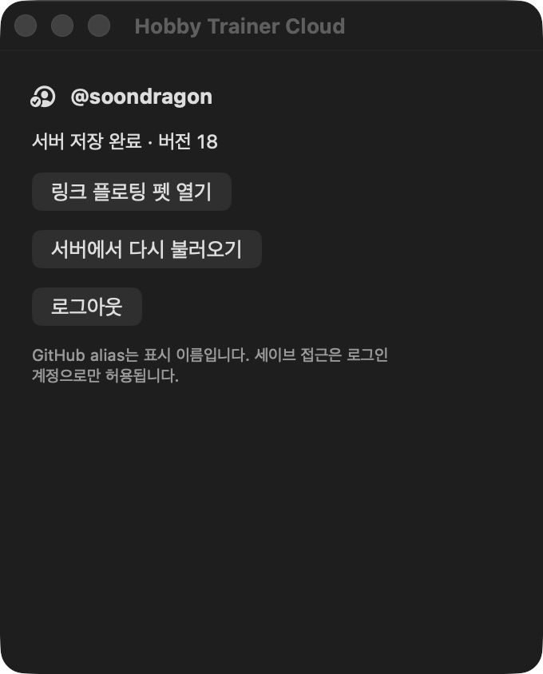
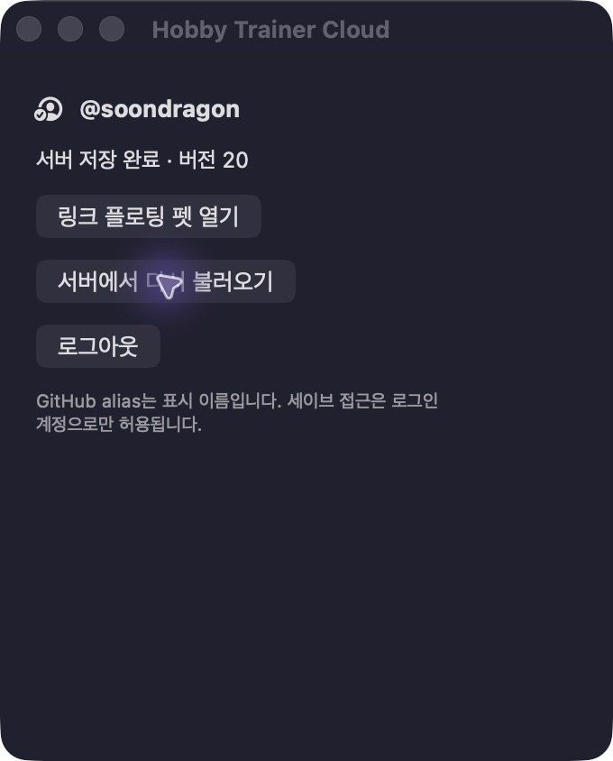
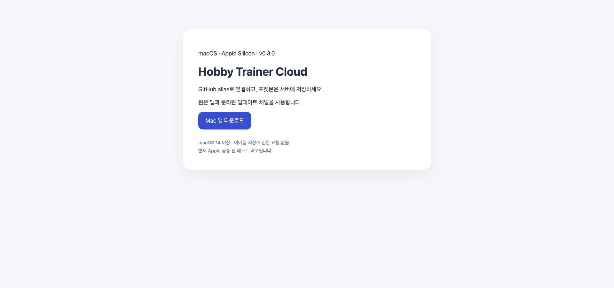

# Cloud application updates and upstream integration

The cloud application explicitly selects the `soondragon/hobby` release channel at startup, regardless of packaging identity. Only the exact upstream bundle identifier `io.github.chattymin.poketokenbar` may use `chattymin/PokeTokenBar` and its Homebrew cask updater. Unknown, preview and cloud bundles fail closed to the cloud channel. Both fetched and directly considered links must belong to the selected channel: cloud artifacts on the canonical cloud host, or upstream GitHub release tags for the upstream channel. Applying an update validates the link again. Cloud updates never invoke Homebrew or the upstream launch agent.

The cloud channel now checks `https://hobby-trainer.vercel.app/api/app-release`. The Ed25519 publisher signature is checked against the bundled public key before accepting metadata. Downloads are restricted to the canonical cloud host/path, bounded by signed byte size, checked against SHA-256, unpacked into a sibling staging folder and checked for bundle identity/version/code signature before installation. The old bundle is retained for rollback. No GitHub repository token is bundled or requested.

## Upstream integration, 2026-10-16

Merged upstream `04b12da` from baseline `c328d5c`: alternate species forms, Pokédex back navigation, and stable rare-candy reset handling. The conflicts in `CompanionStore` and `SpriteLoader` were resolved by preserving cloud mutation authorization and the encounter front/back sprite separation while adopting general `PokemonForm` values.

`CloudSaveWire` maps the new domain fields to the existing schema-v1 wire aliases (`form` → `unownForm`, `pendingForm` → `pendingUnownForm`, `representativeForm` → `representativeUnownForm`). Existing server reads are supported by upstream's legacy decoder. Default non-Unown forms remain absent on the wire so preexisting server identity fields do not change just because the app was upgraded. Nondefault forms retain their raw values. No production schema, authentication settings, user credentials or saves were migrated.

Regression coverage includes rejecting a newer upstream release for the cloud bundle, accepting only cloud release URLs, ensuring Homebrew is unavailable in that channel, legacy wire-key round trips, default-form identity stability and separate back-sprite cache keys.

## Local validation

- Upstream HEAD rechecked against the remote: `04b12da9bb426ee4ff1ffc0e124c7cb4011dc914`.
- Focused Swift integration run: 153 executed, 152 passed, one opt-in all-form PokéAPI network parity test skipped, zero failures. Includes updater isolation, cloud persistence/synchronization/wire encoding, GitHub authorization, encounters, form/Unown support, rare candies, Pokédex navigation/filter/paging and save transfer.
- Python backend auth/API/move-catalog regression: 28 passed (Python 3.12).
- Temporary mutation changed the cloud repository to upstream: the cross-channel rejection assertion failed as expected; the unmodified policy passed. Production source was not mutated for that check.
- Release build and strict ad hoc signature verification passed. Local artifact: `build/cloud-integrated-20261016/PokeTokenBar Cloud.app`.
- The full coverage gate was attempted but interrupted after several minutes of unrelated real local-log scanning and macOS Contacts/CoreData XPC retries. It is not reported as passed; no full-suite coverage percentage is claimed. An initial test used shared defaults and failed due to a previously skipped test version; it now uses isolated defaults and passes in the final focused run.
- No remote push, hosted deployment, production schema migration or public release was performed. The existing installed app was left running because it showed unsaved growth input pending the server rate limit. It was not overwritten or forcibly discarded. The new artifact has not been authenticated interactively; its cloud compatibility is covered by the local regression run above.

## Recovery and signed feed candidate, 2026-10-16

The pending production save was larger than the 25M burst cap and could never succeed by waiting for that capped bucket alone. Migration `queue_offline_growth` retains the 25M initial burst and 100k/second budget: an oversized request registers a server timestamp and SHA-256 of its immutable state/rules, waits for the remaining budget, then commits once through the original transition validator and CAS path. The durable admission is committed before HTTP 429/Retry-After is returned. Retries do not duplicate growth or bypass ownership. The private queue has RLS and no direct trainer_api table grants.

Recovery backend deployment `dpl_DVJ4tTWBXpPXqTqtDykpomSxWcHy` was promoted. The existing app's exact pending request then completed through revision 18, usedSinceInstall=70226785, with no remaining admission and without discarding progress. Its bundle was backed up outside the active installation before replacement.

The locally installed 0.3.0 candidate completed real GitHub sign-in and server save revision 19, then restored the same account and revision through Keychain after normal quit/relaunch. Strict installed signature verification passed. The signed release archive was verified locally, downloaded from candidate deployment `dpl_BgbFcnN81VpZC8T2jtT69Bi4Fn7W`, and matched its advertised byte size and SHA-256. Final canonical feed promotion is pending the user's cloud version confirmation required by CLAUDE.md; this is not yet claimed as the final published release. End-to-end self-update from an older client remains pending until that feed is promoted.

Native focused integration run: 111 executed, 110 passed, one optional all-form network parity test skipped, zero failures. It includes the actual signed archive extraction and bundle checks. The prior full-suite gate remains incomplete as recorded above; no total coverage claim is made.

Final backend regression run: 64 tests passed on the disposable local PostgreSQL database, including the public feed/download/landing and committed Retry-After behavior. The private queue advisor findings are intentional deny-all RLS with RPC-only access; no direct API grants were introduced. The existing password-auth leaked-password advisory concerns unused Supabase password authentication, not the profile-only GitHub application flow.

Final candidate supersedes the earlier stage: `dpl_4YKBd7XaXwJeQpxw63noPahjAKBv`, `https://hobby-trainer-2icyofzgl-yong-35b2.vercel.app/app`. Its signed archive SHA-256 is `ca16dd6675fad75ff5a23b1c87a779d44375501baa6a6f4a945820c4d47ea979` (3497994 bytes). The downloaded staging archive matches the metadata; six final signature/archive/cancel tests pass. The installer now terminates its own helper if the synchronous pending-save exit dialog cancels termination, leaving the existing installation intact. Retained immutable archive URLs remain downloadable across a feed promotion.

The new app's real automatic Retry-After request completed without manual retry through server revision 21. The final installed binary exactly matches the final archive source, completed a fresh GitHub login through revision 25, and restored/saved through revision 26 after normal quit/relaunch. It is left connected. Canonical final package/feed promotion still awaits the explicit cloud version confirmation; the recovery API remains live. Temporary deployment CLI credentials are logged out/removed when handing off that confirmation.

## Final production release 0.3.0, 2026-10-16

The user explicitly approved 0.3.0. Deployment `dpl_4YKBd7XaXwJeQpxw63noPahjAKBv` was promoted to `https://hobby-trainer.vercel.app`. The canonical `/app` page and `/api/app-release` now publish 0.3.0. The live envelope's Ed25519 signature was verified against the app's pinned public key; the canonical downloaded archive matches 3497994 bytes and SHA-256 `ca16dd6675fad75ff5a23b1c87a779d44375501baa6a6f4a945820c4d47ea979`.

The actual installation was replaced with that canonical downloaded package and passed strict code-signature verification. Fresh GitHub login completed as @soondragon and server save revision 33. After normal quit/relaunch, Keychain restore loaded revision 33 and the next server save completed at revision 34. No local game save was imported or exported.

A local version-only 0.2.9 bootstrap was tried to exercise the native update UI. The application's standard Settings scene is empty (the upstream settings are hosted inside the menu-bar popover), and the menu-bar entry was not reachable through this automation session. Consequently, a live update-button-to-helper replacement is **not claimed as verified**. The bootstrap was normally quit and replaced by the exact public 0.3.0 archive before the final login/restore checks. Existing focused signature/archive/installer tests remain the automated coverage for that path. Apple notarization remains pending; this is an ad hoc signed test distribution.

