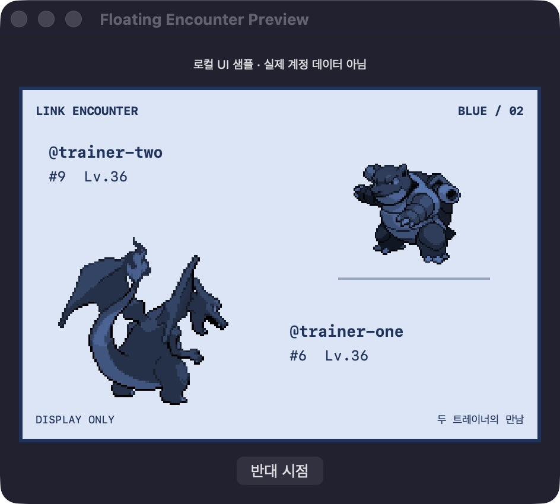
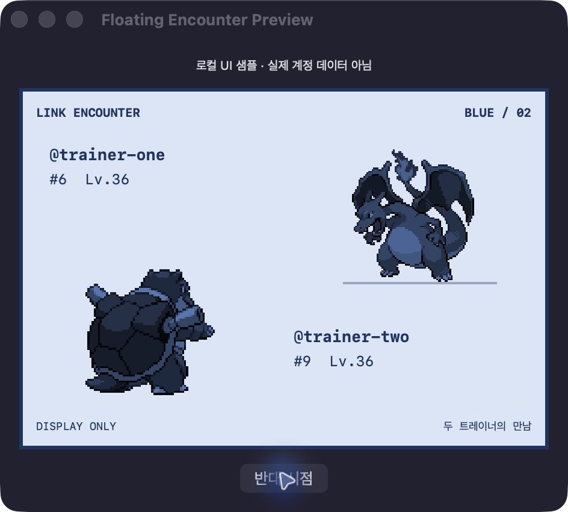
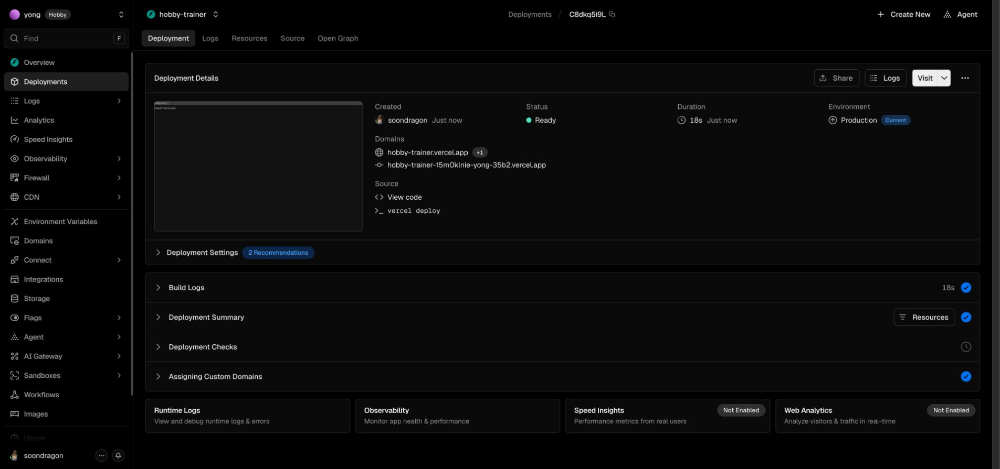
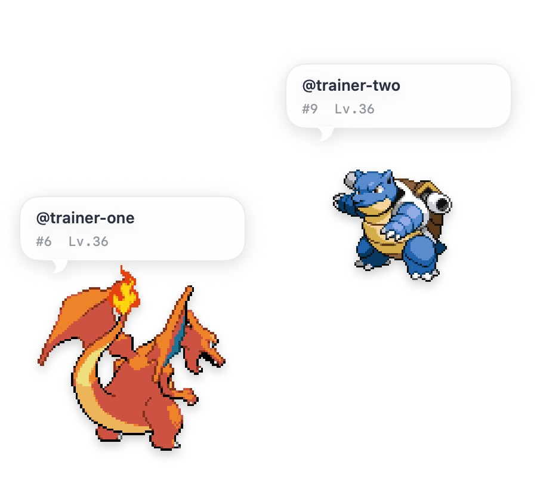
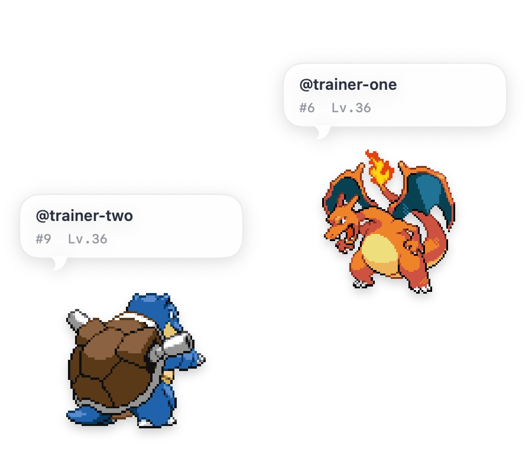
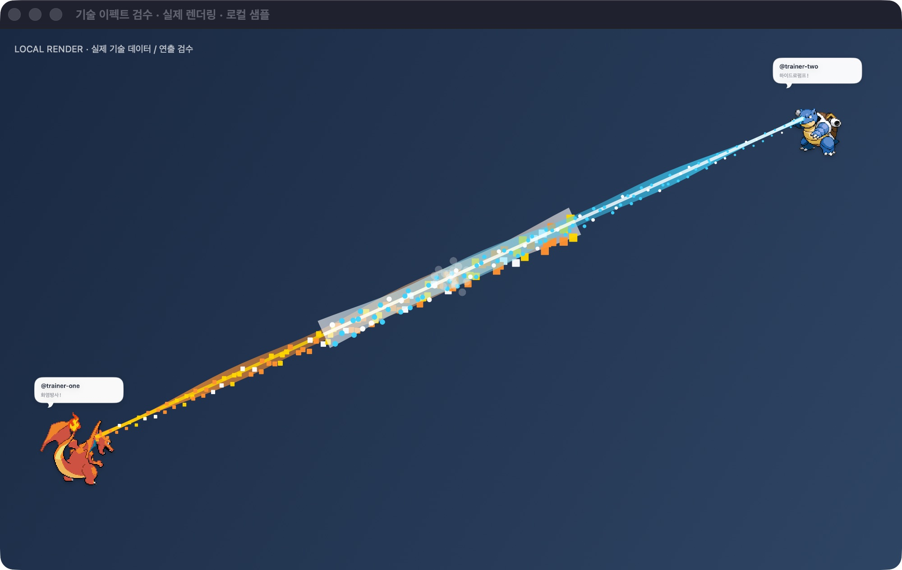
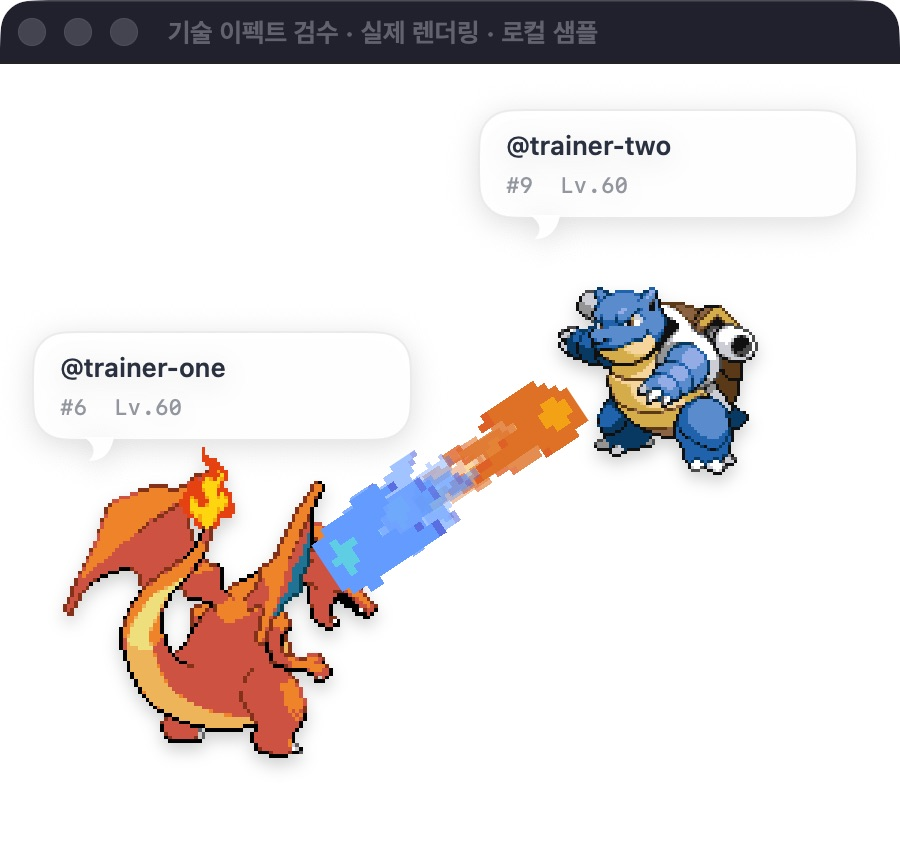

# Two-player floating encounter

The email-free backend was deployed first on 2026-10-15. The implementation now adds participant-only
rooms, invitation codes, owned-individual selection and a floating Blue-style display. Skill casting is now implemented as a visual event. HP simulation, damage, wins and rewards remain outside this version.

## User flow

1. A signed-in player opens the floating encounter panel and selects an owned individual from the
   current active companion or owned collection. An account without a Pokémon sees an explicit
   empty state; the application does not invent or award one.
2. The host creates an invitation; another signed-in account joins with that invitation and selects
   its own individual. Both participants explicitly choose what they share.
3. Each player sees their own Pokémon at the lower left from behind, and the opponent at the upper
   right from the front, using the classic Blue battle composition. Show aliases, species and level.
   Choose a legal skill to cast a synchronized visual event across the desktop. Damage, HP, winners and rewards are not calculated.
4. Changing one's selection updates the other participant's floating panel. Leaving, signing out,
   hiding the panel, loss of connectivity and expiry have explicit states and bounded cleanup.

## Server and privacy

- Account authorization uses the existing opaque application session and stable owner UUID. An alias
  is display data only; a caller-supplied alias or owner UUID never selects another player's save.
- The server derives selections from owned instance IDs, not caller-supplied species, shiny flags,
  levels or stats. Released individuals are not selectable. Recheck ownership when returning a choice.
- Invitations admit at most two distinct accounts. Joining is transactional: two simultaneous joins
  cannot both occupy the second slot. Codes are random, expire, and have bounded authenticated usage.
- Only room participants can read that room. Responses expose only the two selected display
  projections, not provider ledgers, wallet, inventory, full rosters, individual seeds, IVs or tokens.
- Store rooms and participants separately from growth saves. Selection never edits Pokémon growth,
  saves locally, grants progress or broadens public table privileges.
- Room revision checks reject stale mutations. The same participant cannot alter the opponent's
  selection. Session revocation also applies to room requests.

## Native integration

Keep room transport, room state, selection UI, battle-composition view and NSPanel lifecycle in
separate domain-named files. Reuse the existing sprite pipeline; fetch front/back assets at runtime
and provide an explicit loading/failure placeholder. Do not bundle Pokémon art in the application.
The existing single-pet feature remains available independently.

Network updates run only while the encounter panel is visible. Serialize refreshes and mutations,
use bounded intervals/backoff, and discard responses from an older room/account generation.
Signing out closes the panel, clears its in-memory display data and cancels pending work.

## Acceptance evidence required

- Two real GitHub accounts select their own server-owned individuals and see both selections.
- Test outsider reads, forged instance IDs, opponent updates, stale revisions, simultaneous joins,
  expired invitations and revoked sessions against real PostgreSQL.
- Verify selection changes from both perspectives, disconnect/reconnect, leaving and account switch.
- Render and inspect actual floating front/back placement and labels; capture both perspectives.
- Re-run existing cloud save/growth and single-floating-pet regressions. Report local fixtures,
  deployed backend checks and real two-device/account outcomes separately.

## Verification and practical limits

The local PostgreSQL suite covers outsider reads, forged individual IDs, stale revisions, concurrent
joins and selections, expiry, persistent invitation guess limits, immediate session revocation,
minimal projections, collection shiny flags, released selections, body limits and real HTTP UUID
commands. Existing cloud/growth/sprite/native regressions are retained. Room state polls every 0.5
seconds with bounded failure backoff; full owned rosters refresh every 30 seconds. Hiding the panel
cancels polling; logout clears and hides its in-memory data. No encounter or Pokémon save is stored locally.

These actual native renders use clearly labelled local samples, not production account data:

Production account inspection found an active Pokémon for `soondragon`, while `yongari9292` has no
server save or owned Pokémon. A real two-account Pokémon display therefore remains unverified
until the second account starts and obtains its own Pokémon. Do not fabricate production progress
or describe local fixture results as real-account verification.

Invitations contain 122 random bits, are stored only as SHA-256 digests and expire after 30 minutes.
Each account may occupy one active room; joining a full/closed/expired room fails. A closed room
can be replaced with a new invitation. Invitation codes remain only in the host panel's memory;
a restarted host can recover membership but should leave/recreate to share a fresh code.

## Deployment on 2026-10-15

- Production: https://hobby-trainer.vercel.app, deployment `dpl_C8dkq5i9Lqgochn1LvAXLGPZK9Hp` (Ready).
- Migration `20261015075521_floating_encounters.sql` applied to `zaxgjflnqgkrrchhomkv`.
- Final local validation: 50 API/PostgreSQL tests and 278 focused Swift tests passed. Release build
  and strict local code-signature verification passed. The installed cloud app was updated and its
  account window launched successfully; this is a local ad-hoc build, not a notarized public release.
- Production health returned 200. Forged application tokens received 401 at auth, encounter roster
  and encounter command endpoints. Direct room table reads by `trainer_api` and anonymous room
  function execution are denied. Profiles=2, saves=1, maximum save revision=7 remained unchanged.
- GitHub OAuth reauthorization is still pending prior-token revocation approval. No real two-player
  room or combat result is claimed. Production rooms remain empty; all encounter test data was local.

## Transparent desktop presentation (local update)

The native encounter uses a borderless, nonopaque floating NSPanel with a clear background and no
window shadow. Only the two sprites and individual speech bubbles are drawn. Original front/back
positions remain, with full-color sprites. Hover controls or a right-click menu open the separate
invitation/selection settings window, or hide the pets. Hiding cancels polling as before.

The local sample is running in `Floating Encounter Preview.app`; its separate settings window
labels the data as local examples and switches the viewer perspective. The installed cloud app
has the same transparent presentation. This UI-only update does not change the deployed API,
authentication, growth data, ownership checks or combat scope.

Validation: 14 focused native tests passed, including a real NSHostingView bitmap render that
asserts zero alpha in an empty canvas corner, plus borderless/nonopaque window properties.
Release build and local signature verification passed. Both front/back sample perspectives and
opening the separate settings window through the pet context menu were inspected in the actual app.

## Monitor-wide skill events (2026-10-15)

PokéAPI source revision `81d20919845b6a445969b9265aab5cec6b04cece` supplies 649 species, 559 moves and 40,028 learnset rows, pinned to Black 2 / White 2, matching the existing game. Historical move changelogs restore Gen V values (Flamethrower 95, Hydro Pump 120). Korean names are retained; missing Gen V Korean descriptions fall back to source English. Reproduce with `scripts/sync-move-catalog.py --revision <revision>`. Source CSV hashes are in `server/data/move-catalog.json`.

The private server catalog includes 9,082 natural learnset entries. Only an owned selected Pokémon's latest four level-up moves may be cast. The client submits identifiers only. The server checks participant/session/ownership, legal moves, room revision, UUID idempotency and a 2.5-second player cooldown. It retains at most 32 events per room and returns eight. Events do not mutate growth saves.

Two draggable clear pet panels are accompanied by a clear, click-through monitor overlay. Fire/water streams, electricity, physical slashes and status rings are selected from canonical type/class/target data. Shared start times, bounded replay deduplication, hit motion and speech bubbles are supported. This is type-based animation, not 559 individually hand-authored animations. Idle and hidden stages stop animation work.

Validation: 55 API/PostgreSQL tests and 283 focused Swift tests passed, including outsider/forged skill denial, concurrent idempotent commands, cooldown, released ownership, bounded retention and unchanged growth revision. Actual native rendering was inspected. The screenshot below is the inspection window using the production renderer with local sample Pokémon; its backdrop is for inspection only. Real two-account casting remains unverified because the second production account has no owned Pokémon and current OAuth exchange has not been revalidated.

Migration `20261015082301_encounter_skill_events.sql` is applied. Direct catalog/event table reads by the API role are denied. Security advisors report policy-free RLS on intentionally private function-only tables, plus the pre-existing Supabase password leak-check warning (the application uses GitHub authentication). See https://supabase.com/docs/guides/database/database-linter?lint=0008_rls_enabled_no_policy and https://supabase.com/docs/guides/auth/password-security#password-strength-and-leaked-password-protection.

Production deployment `dpl_8ogJAEfMzaaXA99RPUQacT6cgnYK` is Ready at https://hobby-trainer.vercel.app. `/api/health` and species 6/649 catalogs returned 200; species 650 returned 404; unauthenticated room skills returned 401. Production Flamethrower power was checked as 95. Release build, strict signature verification, installation and account-window startup passed. This remains an ad-hoc local app, not a notarized public release.

## Reference composition and pixel spell sheets

The user-supplied reference is the presentation baseline: large own back sprite at lower left, smaller opposing front sprite at upper right, white rounded speech bubbles with alias/species/level and no battlefield background. Default desktop pets now start near each other at the monitor center and remain independently draggable. The inspection view reuses the original 450-point battle composition on a white inspection backdrop; live panels remain transparent.

The previous procedural gradient beams were replaced with six-frame pixel sheets from DevWizard's *Pixel Art Spells* (CC0, https://opengameart.org/content/pixel-art-spells). Six unchanged PNG sheets and attribution ship in the application. Frame decoding is cached once, with nearest-neighbor drawing; type/class selects projectiles, impacts or shields. These are shared visual categories, not individually authored animations for every move. No server, authentication, ownership or growth behavior changed.

Validation: five focused skill tests passed; actual packaged preview cast, release build, strict installed signature verification and main account-window startup passed. No backend deployment was needed for this presentation-only change.

